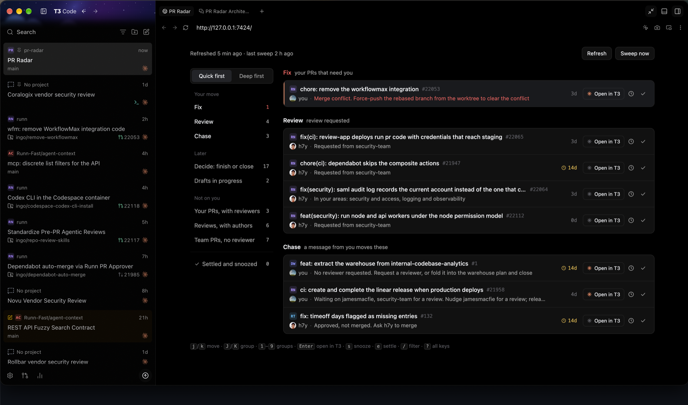

# pr-radar

A local to-do list built from open pull requests across the Runn-Fast org. It
does one thing: it surfaces the pull requests I should pay attention to, and
in what order. It lives inside [T3 Code](https://github.com/pingdotgg/t3code),
in the app's built-in browser.



I've only just built this, so take it with a grain of salt.

It has three queues:

- your own PRs, with what's left on each, from GitHub and the T3 threads that worked on them
- the reviews you're best placed for: requests to you or your teams, then your profile's areas and people
- team PRs that are close to done but stalled

It's a page at http://127.0.0.1:7424, served by `radar.ts` from a SQLite file.
Nothing is hosted, and nothing is installed: it needs Node 24 or later, `gh` and,
for sweeps, the `claude` CLI.

## Why it exists

Most of my pending work lives in T3 Code threads, across several repos and
across work that has no repo at all, like vendor security reviews. I switch
context by project: pick one, see what's left there, work through it. T3 keeps
that list honest without extra UI. It settles threads when their PR merges,
lets me snooze threads so the list doesn't overwhelm me, and hides threads
that are still working and don't need me. pr-radar adds the piece T3 doesn't
have: which PRs across the org need me, and in what order.

### How I run it in T3

- The pr-radar project is pinned, so it's always at the top of the sidebar, one keyboard shortcut away.
- The project's built-in browser panel shows the page. T3 keeps that panel per project, so I can widen it for pr-radar alone.
- The project holds one otherwise empty thread. Claude in that thread has the radar's context, so I can ask it about what the page shows. Mostly I just read the page.

It's a bit of a hack to get this kind of view into T3 Code, but it works
because the pieces fit together. The same approach should work anywhere that
can show a local page next to an agent, such as Claude Desktop.

### What it adds

- **Claude judges each PR.** A sweep reads what moved on a PR, including its T3 threads, and writes down where it stands and the next step. It then picks what needs me most.
- **Deep work or quick wins.** The order follows the time of day: big reviews and real fixes in my deep-work block, merges, nudges and small reviews in the quick-win block.
- **A profile from my history.** The `pr-radar-setup` skill builds a reviewer profile from a year of PRs I authored and reviewed, then tunes it with me. It covers the areas I know, the people I review and the teams whose requests count.
- **Keyboard shortcuts.** `j` and `k` move between PRs, `Enter` opens the PR in T3, `s` snoozes, `e` settles, and `?` lists the rest. The missing piece is focus: keys only work once the built-in browser has focus, so click the page or press F6 first.

### Why it's this small

One file does the work with tools that are already on the machine: `gh` for
fetching, the `claude` CLI for sweeps, and Node for serving. The page is a
static file. The only reason it needs a server at all is the SQLite
connection.

- `web/index.html` is one static page with no dependencies.
- `radar.ts` is a single TypeScript file of about 1,600 lines. It talks to `gh` and `claude` and keeps its state in a small SQLite database.
- It reaches T3 through `t3code://` links and the `t3` CLI.
- T3 Code does everything else: projects and threads, file browsing, diffs, side conversations, agent orchestration, and a thousand other things I don't want to maintain.

## Two cadences

| | What | How often | Cost |
|---|---|---|---|
| **Refresh** | Poll every open PR's fingerprint (head, CI, review decision, mergeable, updated). Fetch details only for PRs that changed. Rescore, diff, and record events like "CI passed" or "review requested from you". Optionally notify. | Every 5 min in working hours and every 60 min outside them. Also on the page's Refresh button. | About 2 GraphQL points when nothing changed, with a full fetch (about 110 points) every 6 hours. No model. |
| **Sweep** | Claude reads T3 threads and review comments for PRs that moved, writes a note per PR, and picks up to three things for your current block of the day. | Started by the server when something moved (one of your PRs or its thread, a new review request, a new block of your day), at most every 30 minutes. Also on the page's Sweep now button. | A headless `claude -p` run with an allow-list of tools and a budget cap. A quiet sweep costs about $0.30. Transcripts go to `users/<login>/logs/sweeps/` for 7 days. |

## Layout

- `radar.ts`: the engine, the CLI and the server, in erasable TypeScript that Node runs directly. Run `node radar.ts --help`. Built on Node's own modules: `node:sqlite`, `node:http`, `node:child_process`, `util.parseArgs` and `Temporal`.
- `package.json` (`type` and `engines` only) and `tsconfig.json` (type-check only, `noEmit`).
- `web/index.html`: the page, in T3 Code's default theme. A sidebar of groups (Your move: Fix, Review, Chase; Later; Not on you; Settled and snoozed) and one table per group. It polls `/api/board` every minute and posts Settle, Snooze, Bring back and Refresh back to the server.
- `users/<login>/`: `profile.json` (scoring weights), `profile.md` (the same in prose), `config.json` (rhythm, refresh cadence, notifications, schedule). The `radar.db` and `logs/` in there are gitignored.
- `.agents/skills/pr-radar`: the sweep, which is the judgement half.
- `.agents/skills/pr-radar-setup`: profile, rhythm, notifications, install and schedule for a new person. Start here.
- `bin/install-launchd`: keeps the server running at login.

## Running it

```sh
node radar.ts refresh --user <login> --full   # first fill
node radar.ts serve --user <login> --sweeps   # or ./bin/install-launchd <login>
node radar.ts sweep --user <login> --dry-run  # would a sweep run now, and why?
node radar.ts t3-projects --user <login> projects.json  # load the badges from saved t3_project_list output, when T3 isn't on this machine
```

To type-check after a change (TypeScript and Node's types stay out of `package.json`):

```sh
npm install --no-save --no-package-lock @types/node@24   # once, into the gitignored node_modules
npx -y -p typescript tsc --noEmit
```

## Design notes

- **Fetching is a script; judgement is Claude.** The server never calls a model. A sweep only reads what moved: own PRs whose PR or T3 thread changed since their note.
- **Sweeps run outside T3.** The server decides when Claude is worth calling, so a quiet day costs nothing. T3 is used for what it's good at: deep links, the built-in browser, and its thread data.
- **T3 threads come through T3's CLI.** Each refresh runs `t3 thread list --json --project <id>` (from `~/.t3/bin/t3`, or `T3_CLI`) in parallel for the T3 projects whose repo has an open PR here, plus projects with no GitHub repo. It links every thread to the PRs T3 says it created or pushed to, settled threads included, since a settled thread on an open PR is still the one to open. Before a sweep, the server runs `t3 thread show` for the newest thread of each PR that needs a note, and `todo` hands those messages to the sweep. The CLI reserves a loopback port, so it can't run inside an agent sandbox; that's why the server fetches and the sweep only reads. It needs T3 running; if it fails, the last links stay.
- **No per-PR watches.** T3's `watch_pull_request` starts an agent turn on every event, which suits one PR you're actively babysitting, not a hundred. The light poll replaces it here.
- **Rhythm.** Every item is tagged `deep` or `quick` (a review counts as deep at 300+ lines or 15+ files). Sweeps pick for your current block: deep work in the morning, quick wins in the afternoon, or whatever your config says.
- **Into T3 Code.** Each row links its T3 threads with `t3code://threads/<environmentId>/<threadId>`, and offers "New T3 thread" as `t3code://new?pr=<url>&prompt=<text>`. T3 opens that link as a draft, and nothing runs until you press Send. T3's built-in browser asks before following any app link, so the page hands these links to the server (`POST /api/open`, same origin only), which opens them with macOS `open`. If that fails, the click falls back to the plain link and its prompt. Both routes come from T3's `packages/shared/src/promptLinks.ts`. T3 also has its own `/pull-requests` view (with `involvement=authored|reviewing`), but it has no app link, and it doesn't know your profile or rhythm.
- **Project badges match T3.** Each refresh reads T3's projects, read-only, from T3's own database (`~/.t3/userdata/statev2.sqlite`, table `projection_projects`) and caches them. T3's CLI has no project list, so this leans on an internal table a T3 update could change; if the read fails, the cached list stays. T3 doesn't store a project's repo, so like T3, radar.ts asks git for each project folder's `origin` remote and top level. A PR's repo maps to the T3 project with that repo (the one opened at the repo root wins), and the badge uses the project's icon or T3's own monogram rule (`projectMonogram` and `projectColor` in `radar.ts`, decompiled from the app). Repos with no T3 project get the monogram of their name.
- **T3 snoozes count here too.** The same thread list says which threads are snoozed, and a PR linked to one moves to "Settled and snoozed" until the snooze ends or you unsnooze the thread in T3. It's one-way: snoozing in pr-radar doesn't snooze the thread.
- **Read-only toward GitHub.** Nothing here comments, reviews, approves or merges.

History: written in Python first, ported to dependency-free Node on 2026-11-27
with identical output (checked by running both against copies of the same
database). It started as an artifact-backed skill in `Runn-Fast/agent-context`
(`projects/pr-radar/`). It moved here when the artifact proved unable to
refresh itself.
